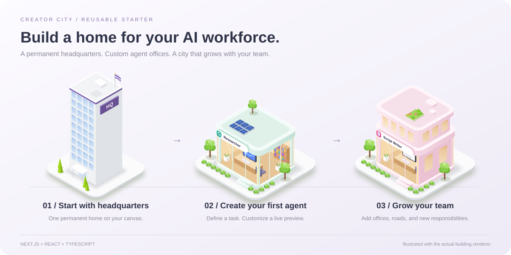

# Creator City

A reusable Next.js, React, and TypeScript boilerplate for a visual AI agent workspace: one permanent headquarters, customizable agent offices, and isometric roads.



## Start locally

Use Node.js 22 (`.nvmrc`) and npm. The minimum supported Node version is declared in `package.json`.

```bash
npm ci
npm run dev
```

Open [localhost:3000](http://localhost:3000). The homepage `/` is the landing page. It renders without a database, API key, or environment variables; signing in and the dashboard need the variables in `.env.example`. `.env.example` is a safe template for settings you add later.

## What is included

- A single permanent headquarters with Empire, Crown, and Twin designs.
- A reusable agent creation dialog with a live building preview.
- Customizable offices, roads, selection, dragging, zoom, and day/night mode.
- Typed public APIs, CSS modules, SVG renderer tests, and illustrated developer docs.
- Working lint, type-check, test, and production build commands.
- [AGENTS.md](AGENTS.md) and [CLAUDE.md](CLAUDE.md) for AI-assisted development.

This starter includes PostgreSQL/Drizzle scaffolding, Tailwind CSS, and Lucide icons alongside the city UI. AI execution, storage, and city persistence are extension points, not configured services.

## Authentication

`/sign-up` and `/sign-in` use [CloudHike.dev Auth](https://cloudhike.dev/docs/md/auth) for email/password and Google sign-in, then redirect to `/dashboard`, a signed-in-only area with a collapsible sidebar (headquarters switcher; City, Artifacts, Post, Calendar, Agents, Accounts, and Settings pages; Artifacts is a file explorer of everything agents produced, see [docs/agent-runtime.md](docs/agent-runtime.md#artifacts)) and a header with the sidebar toggle and profile menu. A user who has no headquarters yet is sent to `/headquarters/new` first, where they name it and pick a design, colors, icon, height, spire, and landscaping with a live preview; **Create Headquarters** saves it to Strapi and opens the dashboard. **Settings** changes the time zone, headquarters design, new-agent defaults, publishing approval, and display name, and can clear shared memory or delete the headquarters (see [docs/headquarters.md](docs/headquarters.md#settings-page)). The CloudHike token is kept in an HTTP-only `cc_session` cookie and checked with `get-session` on each request (`lib/auth/`); **Sign out** in the avatar's profile menu revokes the session with CloudHike, clears the cookie, and returns to `/sign-in`. Each user also gets a record in Strapi's built-in **Users** collection (`lib/strapi.ts`); sign-in creates it if it is missing, so an earlier failed sync repairs itself. Strapi stores a random unusable password because credentials are only checked by CloudHike.

Both pages share a split-screen frame (`app/(auth)/auth-shell.tsx`). The form sits on the left. On screens 1024px and wider, the right side shows a decorative city preview (`auth-showcase.tsx`) built from `BuildingGlyph` and `RoadNetwork`, with a day/night toggle and a rotating sample activity feed. That preview is static marketing art: it saves nothing and dispatches no agent work.

Setup: copy the `AUTH_*`, `STRAPI_URL`, and `STRAPI_API_TOKEN` keys from `.env.example` into `.env.local`. The Strapi token needs `find` and `create` on Users-permissions → User and on Headquarter. Create the `headquarters` collection first; its schema is in [docs/headquarters.md](docs/headquarters.md#save-a-users-headquarters-in-strapi). For Google, enable it on the CloudHike Auth card and add each app origin (for example `http://localhost:3000`) under the sites users can return to.

### Cloud computer for agents

Agents with the **Cloud computer** tool get a [CloudHike.dev cloud computer](https://cloudhike.dev/docs/computers): Chrome with the user's saved sign-ins, a terminal, and files. It starts when an agent needs it and shuts down when the agent finishes. When an agent needs the user, its building shows **Needs you**, and the City header and chat show the request until the user answers. The user may need to sign in to a site, solve a captcha, or choose a service such as ElevenLabs or Deepgram for a voiceover. The agent then continues by itself. Agent popovers show a small live preview that opens full screen.

### Working with agents

- **Artifacts everywhere**: every agent and headquarters can find and open saved artifacts (`list_artifacts`, `read_artifact`), including files from earlier tasks.
- **Uploads**: attach images, videos, audio, PDFs, text, or Office files to any chat. You can use the paperclip, drag and drop, or paste. Each file is saved as an `upload` artifact the agent can open.
- **Questions and approvals**: an agent asks before outward-facing actions (`confirm_action`) and when it is unsure which tool, service, or website to use (`ask_user`). A question shows as a bubble above its building and in its chat, where the user answers with buttons or by typing.
- **Connected accounts**: on **Accounts**, connect Instagram, YouTube, X, LinkedIn, Notion, Google Sheets, and any other [Composio](https://composio.dev) app with its own sign-in page, and choose which agents may use each one, read-only or with posting (asking you first by default). Agents find and use the app's tools themselves, publish, schedule, or draft posts (drafts wait on **Post** and the **Calendar** for you to schedule or publish), and show a **Connect** card in chat when an app they need is missing. See [docs/accounts.md](docs/accounts.md).
- **Queue**: requests sent to headquarters while it works wait in a queue and run in order.
- **Clear chat** and **fresh conversations per task**: earlier messages stop showing and stop reaching the model. Artifacts, uploads, memory, task history, and settings are kept.

See [docs/agent-runtime.md](docs/agent-runtime.md). Setup: add `COMPUTERS_API_URL` and `COMPUTERS_API_KEY` to `.env.local` and the two Strapi collections described in [docs/cloud-computer.md](docs/cloud-computer.md). For connected accounts, add `COMPOSIO_API_KEY` and the collections in [docs/accounts.md](docs/accounts.md#strapi-collections).

## Use the starter

The homepage is a landing page built from the real building components: an animated starter city in the hero, the six starter agents, and the three headquarters styles. Edit `app/page.tsx` for copy and sections and `app/_landing/` for the hero scene and styles. The reusable city, roads, agent creation dialog, and all headquarters styles remain available through the public component API.

To build an interactive workspace, start with the [complete integration example](docs/integration.md).

## Reusable components

```tsx
import {
  AgentCity, AgentBuilding, HeadquartersBuilding, BuildingGlyph,
  AddAgentDialog, Road, RoadNetwork,
} from '@/components/agent-city';
```

The host owns agents, city configuration, selection, and persistence. Components supply rendering and interaction callbacks. [Copy the complete integration example](docs/integration.md) to start a new workspace.

## Documentation

| Guide | Contents |
| --- | --- |
| [Documentation home](docs/README.md) | Illustrated overview and source map |
| [Integration](docs/integration.md) | Complete city + creation/removal example |
| [Component API](docs/component-api.md) | Props, exported types, options, and defaults |
| [Headquarters](docs/headquarters.md) | Illustrated Empire, Crown, and Twin designs |
| [Architecture](docs/architecture.md) | State ownership, creation flow, coordinates, and invariants |
| [Customization](docs/customization.md) | Templates, palettes, roads, styles, and layout |
| [Connected accounts](docs/accounts.md) | Composio connections, agent access, app tools, Connect cards, scheduled posts |
| [Extending the starter](docs/extending.md) | Persistence, AI execution, verification, and current limits |

## Project layout

```text
app/
  page.tsx                   Landing page (hero city in _landing/)
  globals.css                Tailwind CSS and original theme tokens
components/agent-city/       Reusable components, types, tests, and styles
db/                          Original PostgreSQL/Drizzle scaffold
drizzle.config.ts            Database configuration
postcss.config.mjs           Tailwind PostCSS configuration
docs/                        Illustrated component documentation
Isometric Campus.html        Original design reference
AGENTS.md                    Shared AI coding instructions
CLAUDE.md                    Entry point to shared instructions
eslint.config.mjs            ESLint configuration
```

The original database scaffold, Tailwind/PostCSS setup, and Lucide icons are included. The original design source is preserved in [Isometric Campus.html](Isometric%20Campus.html). Generated build files and local environment files are ignored by Git.

## Commands

| Command | Purpose |
| --- | --- |
| `npm run dev` | Start local development |
| `npm run lint` | Run ESLint with zero warnings allowed |
| `npm run typecheck` | Generate Next route types, then check TypeScript |
| `npm test` | Run road geometry and building renderer tests |
| `npm run build` | Original Next.js production build |
| `npm run build:webpack` | Verified webpack production build |
| `npm start` | Serve a completed production build |
| `npm run check` | Lint, type-check, test, and build |
| `npm run db:generate` / `npm run db:push` / `npm run db:studio` | Original database tooling |

`npm run check` uses the webpack fallback because Turbopack stalled in the development environment. Browser visuals, focus behavior, and pointer interactions still need browser QA; renderer tests use a DOM double. See [verification and limits](docs/extending.md).

## Build your app

Start in `app/page.tsx` for your app page and follow `docs/integration.md` to compose an interactive workspace. Reuse the library through `components/agent-city/index.ts`. Keep the one-headquarters rule in host state; `AgentCity` is a generic renderer.

Add persistence and job execution behind your own server boundary. A badge is display status; a road does not dispatch work. Keep agent definitions and saved layout separate so rearranging your city does not change execution behavior.
