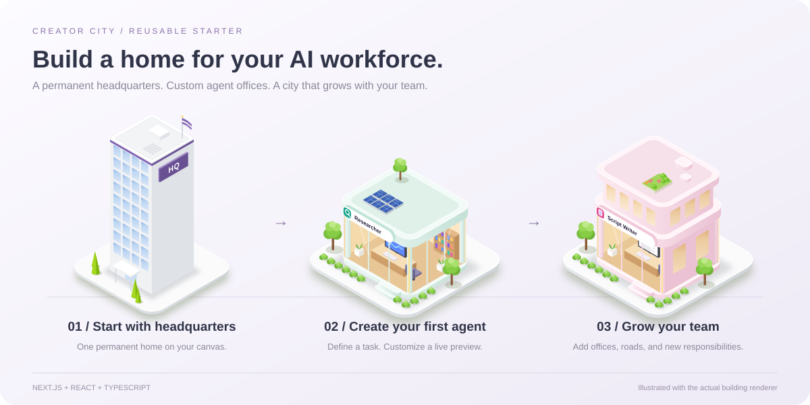

# Agent City components

Reusable city, building, road, and agent creation dialog components. Import their public API from `@/components/agent-city`.

## Documentation

| Guide | Contents |
| --- | --- |
| [Quick start](../../README.md) | View the documentation illustrations at `/` |
| [Complete integration](../../docs/integration.md) | City + dialog + creation/removal in one client component |
| [Headquarters styles](../../docs/headquarters.md) | Illustrated reusable Empire, Crown, and Twin designs |
| [API reference](../../docs/component-api.md) | Every component, exported type, option, and default |
| [Architecture](../../docs/architecture.md) | Illustrated creation flow, ownership, rendering, coordinates |
| [Customization](../../docs/customization.md) | Building templates, palettes, roads, and styles |
| [Extending the starter](../../docs/extending.md) | Persistence, execution, validation, and known limits |

## Public components

- `AgentCity`: controlled canvas with building selection, movement, and roads.
- `AgentBuilding`: standalone SVG building preview.
- `HeadquartersBuilding`: standalone headquarters preview with height-aware framing.
- `BuildingGlyph`: building group for a custom SVG.
- `AddAgentDialog`: name/task/appearance draft with live preview.
- `Road` and `RoadNetwork`: isometric roads and merged junction layers.

The example host owns data and the permanent headquarters rule. Components do not save data or execute AI tasks. Cancelling creation discards the draft; the host commits and closes on submission.
