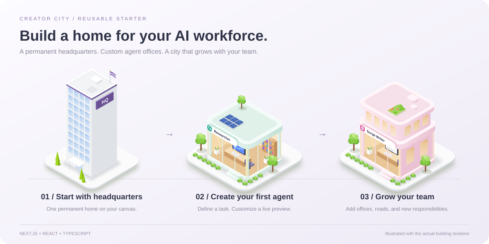
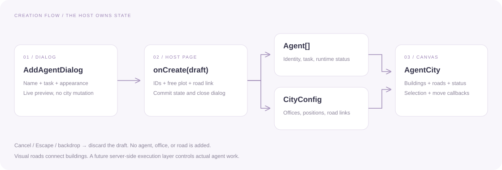

# Creator City developer guide

Build a content creation workspace by composing small UI components around your own application state. The default example starts with one headquarters and zero agents. A new agent gets a customized office, a free plot, and a road back to headquarters.

## Choose a starting point

| Your goal | Read |
| --- | --- |
| Run the starter | [Root README](../README.md#start-locally) |
| Add the components to a page | [Complete integration](integration.md) |
| Look up a prop or configuration value | [Component API](component-api.md) |
| Understand the creation and rendering flow | [Architecture](architecture.md) |
| Choose or customize headquarters | [Headquarters guide](headquarters.md) |
| Change the look or road layout | [Customization](customization.md) |
| Connect storage and actual AI jobs | [Extending the boilerplate](extending.md) |

## A draft becomes a workspace

`AddAgentDialog` gathers a name, task, and building appearance. Its `onCreate` callback gives the draft to your page. Your page allocates IDs and a plot, updates `Agent[]` and `CityConfig`, then closes the dialog. `AgentCity` renders those two data sets together.

Headquarters permanence is an application rule in the supplied example, not a restriction imposed by the generic canvas. Keep that rule in your own state mutations when adapting the boilerplate.

## Where to edit

| Concern | Source |
| --- | --- |
| Homepage | [app/page.tsx](../app/page.tsx) |
| Workspace integration | [Complete example](integration.md) |
| Initial headquarters and plot spacing | [presets.ts](../components/agent-city/presets.ts) |
| Creation form | [add-agent-dialog.tsx](../components/agent-city/add-agent-dialog.tsx) |
| Canvas and camera | [agent-city.tsx](../components/agent-city/agent-city.tsx) |
| Building rendering | [agent-building.tsx](../components/agent-city/agent-building.tsx), [renderer.js](../components/agent-city/renderer.js) |
| Roads and routing | [road.tsx](../components/agent-city/road.tsx), [road-geometry.ts](../components/agent-city/road-geometry.ts) |
| Data contracts | [types.ts](../components/agent-city/types.ts) |

Illustrations are local SVG assets with accessible titles and descriptions. The overview uses the project's actual building drawing primitives; it is an explanatory illustration, not a browser screenshot. The diagrams can be opened directly, embedded in Markdown, or exported to other formats.

## AI-assisted development

[AGENTS.md](../AGENTS.md) defines the shared architecture, invariants, coding conventions, and verification commands for coding agents. [CLAUDE.md](../CLAUDE.md) points to the same instructions. Keep shared rules in one place and update them when moving major components or changing application invariants.

The homepage displays the documentation illustrations from `docs/assets`. The full workspace integration example is documented in `docs/integration.md`. Reusable library components do not import route modules.
