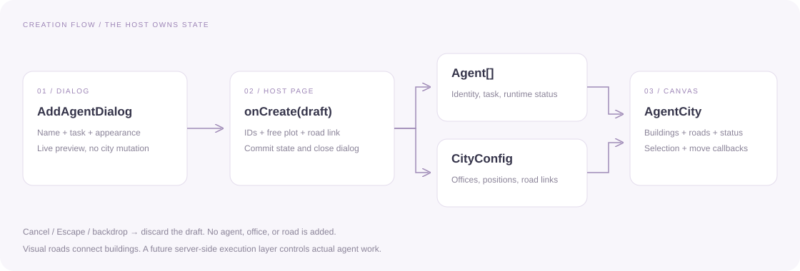
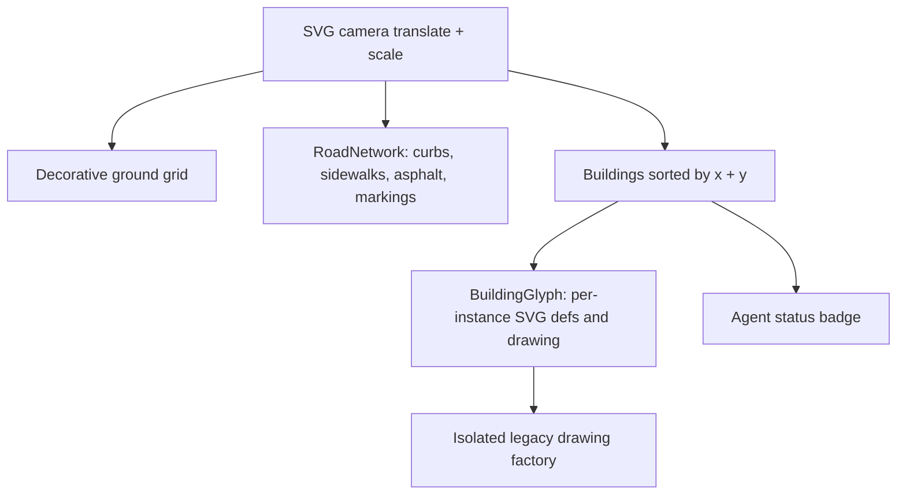

# Architecture and state ownership

[Documentation home](README.md) · [Integration](integration.md)



## Three kinds of state

| State | Owner | Examples |
| --- | --- | --- |
| Workspace data | Host page or future store | Agents, building appearance/positions, links, selection |
| Unsubmitted draft | `AddAgentDialog` | Name, task, palette, roof options, preview lighting |
| Canvas interaction | `AgentCity` | Camera, active pointer gesture, temporary drag position |

The visual library imports no database and makes no network calls. `AgentCity` receives data and emits callbacks. A host must commit a move in `onBuildingMove`; otherwise the canvas is read-only for building movement. Selection also needs a host callback and selected ID.

## Creation lifecycle

1. The host sets dialog `open` to true.
2. The native dialog enters the top layer and focuses the name field.
3. Input changes update a local draft and an isolated `AgentBuilding` preview.
4. Submit validates non-empty trimmed name and task, then calls `onCreate`.
5. The host assigns agent/building/link IDs, chooses a free plot, and commits state.
6. The host closes the dialog and selects the new building.
7. The canvas resolves agent status by `agentId` and draws its road connections.

Cancel, Escape, close button, and backdrop dismissal request `onOpenChange(false)`. The component unmounts, restores focus, and discards draft state. No agent, building, or road exists until the host commits the callback.

## Headquarters rule

The example's `creatorCity` contains exactly one headquarters. Creation adds only agent offices. The headquarters inspector offers no removal action; the removal handler also guards its ID. Reset restores headquarters-only defaults.

This invariant belongs to the example, not the generic `AgentCity` renderer. Your own imports, delete handlers, reset logic, or API must preserve it. The current example allows headquarters to move. Panning can move any building offscreen; **Reset view** returns the initial camera, not a guaranteed fit to all current positions.

## Rendering layers



`renderer.js` preserves detailed drawings from `Isometric Campus.html`. It is plain JavaScript with a declaration file for the typed React boundary. Every factory instance owns drawing state; `useId` scopes gradients and filters so previews can coexist with the city. Effects draw on the client and clean up when building props change or the component unmounts.

The renderer creates SVG elements with DOM APIs and uses text content for labels. The only embedded markup is the static SVG definitions in the source. External configuration still needs runtime validation before reaching this layer.

## Coordinates

Building positions and road points use world coordinates. Isometric projection is:

```text
screenX = (worldX - worldY) × cos(30°)
screenY = (worldX + worldY) × 0.5
```

Building internals use the same projection with height subtracted from screen Y. `AgentCity` projects building origins; `RoadNetwork` applies a matrix to world-space paths. Both are then transformed by the shared camera. Standalone building previews draw at their local origin.

The demo's free-plot helper uses 290-unit grid spacing. This avoids nearby centers when placing offices, including after deletion. Dragging is continuous: it does not snap, prevent overlaps, or reroute roads around obstacles.

## Agent identity versus office identity

An `Agent` describes a worker's name, task, and runtime status. A building describes a place, its appearance, and position. `agentId` connects them. A road references building IDs, not agent IDs.

The shipped page creates one office for one agent and removes both together. A different host can support multiple offices per agent; when deleting one office, keep the agent if another office still references it. The integration guide demonstrates that check.

## Implementation boundaries

The original standalone HTML remains as a visual reference. Its animated traffic, floating popovers, and localStorage persistence were not copied into the React library. React controls the inspector and creation flow, and the demo intentionally keeps state only in memory. The original database starter is in `db/` with users/posts tables; city persistence is an application extension point.
