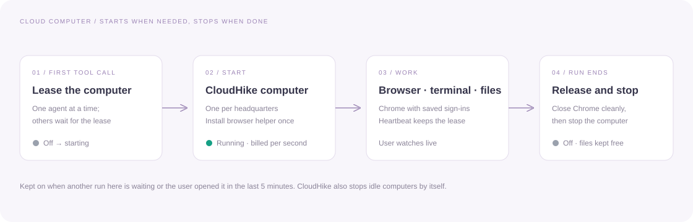
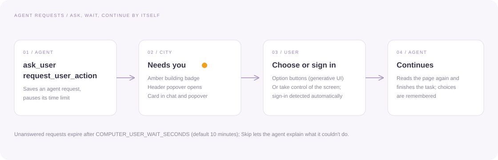

# Cloud computer

[Documentation home](README.md) · [Agent runtime](agent-runtime.md) · [Architecture](architecture.md)

Agents with the **Cloud computer** tool (tool key `computer`) get a [CloudHike.dev Cloud Computer](https://cloudhike.dev/docs/computers): a Linux desktop with Google Chrome, a terminal, and a file system. They use it when their own knowledge and other tools aren't enough. Typical uses are live web pages, a platform the user works with, a service with no direct integration (for example a voiceover on ElevenLabs), downloading or converting files, and running commands.

## Setup

1. In the CloudHike dashboard, deploy **Cloud Computer** on the project (or `deploy_services` with `computer` through the CloudHike MCP server).
2. Put `COMPUTERS_API_URL` and `COMPUTERS_API_KEY` in `.env.local` (server only; see `.env.example`). Optional: `COMPUTER_SIZE` (`basic`, `medium`, `large`) and `COMPUTER_USER_WAIT_SECONDS` (how long an agent waits for the user, default 600).
3. In the Strapi project, add the collections below. They are defined in `src/api/computer-session`, `src/api/agent-request`, and `src/api/external-wait` (for [long waits](#long-waits)). The API token needs find, findOne, create, update, and delete on all three.
4. Add `waiting` to the `status` enumeration of the **Agents** collection.
5. Turn on **Cloud computer** in an agent's **AI settings**. New Research and Publishing agents get it by default; existing agents keep their saved tools.

Without the two environment variables, the tool reports that the computer isn't configured and the city hides the computer UI.

## How agents use it

Connected apps come first: when the app a task is about is connected for the agent (see [Connected accounts](accounts.md#connected-apps-before-the-cloud-computer)), the agent uses its app tools instead of the website, and opening that app's site with `browser_open` returns a reminder to do so.

| Tools | What they do |
| --- | --- |
| `browser_search` | Search the web and return the top results as a list (title, link, snippet), usually within a few seconds. `recency` (`day`, `week`, `month`) limits results to recent pages, for "today" and "trending" searches. It searches Google (accepting Google's cookie-consent page automatically where one appears), then falls back to Bing when Google shows a bot check, returns nothing, or doesn't answer. If both engines are blocked, the agent asks the user to solve the check (**Needs you**) and searches again by itself. |
| `browser_open`, `browser_read`, `browser_scroll`, `browser_history`, `browser_tabs` | Navigate and read pages. Results are compact text: URL, title, page text (paged with `offset`), and the page's interactive elements with `[id]`s. |
| `browser_click`, `browser_type`, `browser_select`, `browser_key` | Act on elements by `[id]`: click buttons and links, fill forms, choose options, press keys. |
| `browser_do` | Run up to 12 steps (click, type, select, key, scroll, wait for text) in one tool call, stopping at the first failure. Later steps can target an element by its visible label (`target`) instead of an `[id]`, because ids change when the page changes. It returns the final page and, if asked, a screenshot. Agents use it to finish a form or a click path in one turn instead of one turn per click. |
| `browser_extract` | Evaluate a JavaScript expression in the page to pull structured data. |
| `browser_upload` | Put files from the computer into the page's file input (by the `[id]` of the upload button, drop area, or input). No file picker is involved. If the site only creates its input on click, the helper clicks it and catches the file chooser. |
| `browser_wait` | Wait in one step, up to 15 minutes, while a site uploads, renders, or exports. It returns when text appears, when text disappears, or when a browser download finishes (it returns the file's path). The agent's time limits are paused while it waits, and a page busy rendering is never interrupted. |
| `wait_for_external` | Pause the task while a website keeps working for a long time on its own servers (Claude building a video, a cloud render). The run ends and the computer turns off; the page is checked every few minutes and the task continues in a new run when it is ready. See [Long waits](#long-waits). |
| `computer_screenshot`, `computer_action` | See the whole desktop (image) and use the mouse and keyboard by pixel coordinates, for native dialogs, file pickers, or canvas apps. `computer_action` takes a list of up to 10 actions, runs them in order, and returns one screenshot of the result. |
| `terminal_run` | Run bash as root (output trimmed to the last 12,000 characters). |
| `files_list`, `file_read`, `file_write`, `file_download` | Manage files; relative paths are under `/root/creator-city`. |
| `file_save` | Upload a finished file (audio, video, image, PDF, CSV, text, Office documents, up to 25 MB) to the media library and record it as an artifact. |
| `request_user_action` | Ask the user to sign in, solve a captcha, or do a manual step on the computer, then wait. |
| `ask_user`, `confirm_action` (every agent) | Ask the user to choose, answer, or approve, shown as buttons (generative UI). |

The browser is driven through Chrome's DevTools protocol by a small Python helper. `lib/computer/cc_browser.py` uses only the standard library and is installed on each computer the first time it's used. The TypeScript side runs it through CloudHike's `exec` action, so actions are reliable and need no computer-use model. Screenshots are the fallback for anything outside a web page.

**Responsiveness.** No browser action can leave an agent waiting silently:

- **One command at a time.** Browser commands run one after another per computer: `browserCommand` queues them in the server, and the helper takes a file lock on the computer. The agent shares one tab, so parallel searches would otherwise interrupt each other's page loads. A queued action shows as "… (after the current browser step)". Agents with the computer also run with parallel tool calls turned off (`parallelToolCalls: false`, see `modelSettingsFor` in `lib/ai/agent-factory.ts`), so the model asks for one tool at a time, and `browser_search` refuses a second search while one is still running in the same run.
- **Time limits.** Every DevTools call has a real per-call deadline, and every command stops after 75 seconds (`CC_BROWSER_LIMIT`) with an error the agent can act on.
- **Fast reads.** Pages are read as soon as they are usable: the wanted element exists, loading finished, or the content has been in for a moment. Pages that never finish loading (ads, live feeds) don't hold the agent.
- **Dead sites.** A site that doesn't respond within 15 seconds is abandoned, and the tab goes back to the previous page. Network errors (unknown host, refused connection) return at once.
- **Turn budget.** Computer agents call one tool per turn (parallel tool calls are off because there is one browser tab), so each click used to cost a turn. The rules in `COMPUTER_RULES` tell agents to act directly on the page each tool returns, batch known steps with `browser_do` or a multi-action `computer_action`, and take a screenshot only when the page text isn't enough. Every agent's instructions also state its `maxTurns`, so it can stop with a summary instead of being cut off.
- **Dialogs.** A page blocked by a dialog (alert, leave-page) is reported with how to close it (`computer_screenshot`, then `computer_action`).
- **Exec timeouts.** CloudHike runs one `exec` for at most 120 seconds, so `terminal_run` and `file_download` stay within that limit.

Every agent with the tool gets these rules in its instructions (`COMPUTER_RULES` in `lib/ai/computer-tools.ts`):

- Check whether the user is already signed in.
- Never type credentials. Use `request_user_action` instead.
- Save finished files with `file_save`.
- Call browser tools one after another (not in parallel), and open the best search results instead of searching repeatedly.
- Stop and explain after repeated failures.
- Upload with `browser_upload` and wait with `browser_wait`, never with `terminal_run sleep` or polling.
- Do website work with the browser tools only: open → upload → click → `browser_wait` → Export/Download → `browser_wait` with `download` → `file_save`. A task whose result is a file is done only when that file is saved with `file_save`.

Every agent's `ASK_RULES`, and headquarters, also say that when the user names a website or service, the work stays there. Switching to another method (for example local ffmpeg editing instead of the named web editor) needs the user's approval through `ask_user`.

### Downloads

Chrome saves downloads to `/root/creator-city/downloads` without a save dialog. The helper sets this in the profile's preferences when it starts Chrome, so a Chrome that was already running keeps `~/Downloads` until its next start. `browser_wait` watches both folders. It treats `.crdownload` files as unfinished and reports only files from the current run that it hasn't reported before.

Every agent also gets `ASK_RULES`: when a task needs a capability it has no tool for, it calls `ask_user` with realistic services. It then uses a matching tool, or the chosen service's website through the computer.

## Lifecycle

- **Start on demand.** The first computer tool call in a run leases the computer (`acquireComputer` in `lib/computer/computer.ts`). The lease starts it if it is off and installs or updates the helper. CloudHike keeps one computer per headquarters, using `userId` `hq-<documentId>`, so files and sign-ins are never shared between users.
- **One agent at a time.** The `computer-sessions` record says who holds the lease. Other agents wait up to 5 minutes, shown as "Waiting for the computer (X is using it)". Claims are serialised in each server process and re-checked after writing, so two servers can't both take it. A lease with no heartbeat for 2 minutes counts as free.
- **Stop when idle.** If a run makes no computer tool call for 3 minutes (`COMPUTER_IDLE_RELEASE_SECONDS`), it gives the computer back and the computer shuts down. The agent's status shows "Turned the cloud computer off (not in use)". The next computer tool starts it again. Never while a tool is running or the agent is waiting for the user.
- **Stopped while starting.** If a run is stopped while its computer is still starting, the computer is stopped instead of being left to boot.
- **Stop when done.** When the run ends (`runCityAgent`'s `finally`), the lease is released. Chrome is closed cleanly so cookies reach the disk, then the computer is stopped. It stays on when another run in the same server is waiting for it, or when the user opened it in the last 5 minutes. CloudHike also stops idle computers by itself as a backstop: 3 minutes on Free, 10 on paid plans. The live city stream syncs that state every 20 seconds.
- **Billing.** Only running time is charged. A stopped computer keeps its files and browser profile for free.

## Long waits

Some websites work for longer than an agent run should stay open. Claude building a video can take 20 minutes or more. `browser_wait` keeps the run and the computer going for up to 15 minutes, so for these the agent calls `wait_for_external` instead:

1. **Park.** The agent gives the page (for example the Claude chat URL), what shows it is ready (`readyText`, such as a Download button's label, and/or `busyText`, such as "Generating", that disappears), self-contained `next` instructions, the first check (default 10 minutes), and a time limit (default 90). The tool checks the page once. If it's already done, the agent just continues. Otherwise it saves an `external-waits` record, makes sure the CloudHike Jobs schedule is on, and ends the run (`RunParkedError`). The computer turns off as usual. The task stays **running**; its building and activity show "Waiting for … · next check 14:35", and the chat gets a ⏳ message.
2. **Check.** A [CloudHike Jobs schedule](https://cloudhike.dev/docs/jobs#recurring-schedules) named *Creator City: check external waits* calls the signed `POST /api/jobs/external-waits` every 5 minutes (`WAIT_CHECK_CRON`). For each due wait it starts the computer, opens the page, waits 10 seconds for it to render, and looks for the text, with no model and no tokens. A check takes 1–2 minutes of computer time. It does not check while an agent is using the computer (it tries again on the next tick). When nothing is ready, it turns the computer off.
3. **Resume.** When the page is ready (or asks to sign in, or the time limit passes), the task is queued again and dispatched as a CloudHike Jobs run with `waitId`. The agent starts a new run with the wait's `next` instructions, the original task, and how the wait ended. A timed-out wait lets the agent look itself, wait once more, or explain. The computer is left on for it.
4. **Idle.** When no wait is left, the checker pauses the schedule, so it costs nothing until the next wait.

Only work that keeps going on the website's servers can be parked: an AI chat, a cloud render, an export the site keeps for later. Work that runs inside the browser tab (an in-browser editor exporting) stops when the computer turns off, so agents keep using `browser_wait` for that. **Before relying on it for a site, park once and confirm the result is there after the computer was off.**

**Headquarters plans.** When a step's agent parks, `run_step` tells headquarters the step is waiting. The step stays active (spinner) with `waitingFor` on the plan step. Headquarters runs any independent steps, posts a short progress message, and the request stays **running** without a run. Since it has handed out work, the next queued request can start meanwhile, and the waiting agent is free for other work. When the step's resumed run finishes, its plan step is marked done (or failed), its result is posted to the agent's chat, and the request is queued again. Headquarters then continues with the saved plan and the earlier steps' results instead of starting over.

**Cancel and cleanup.** Stopping a waiting request cancels its waits and settles it at once. The stale-task sweep skips tasks held by a wait. A resumed run that never reports back releases its wait after the task time limit plus 15 minutes. A task can wait at most 4 times.

**Setup.** Add the `external-waits` collection (below) and configure CloudHike Jobs with a public `APP_PUBLIC_URL`. The schedule is created by itself on the first wait. Every 5 minutes needs a paid plan; on Free the shortest interval is 15 minutes, so set `WAIT_CHECK_CRON="*/15 * * * *"`. If CloudHike refuses the schedule, the tool reports it and the agent uses `browser_wait` instead. Without Jobs (local development), the open city page runs the checks once a minute while it is open.

## Sign-ins that persist

Chrome runs with its own profile in `/root/.creator-city/chrome-profile` on the computer's disk. Cookies and sessions survive stops and restarts; this was verified with a stop/start cycle. The helper restores the last session on launch, which also keeps session-only cookies. It clears stale profile locks after a restart. It also points the desktop's `google-chrome` launcher at the same profile, so a site the user signs in to by hand is signed in for agents too. Credentials never pass through Creator City: the user types them on the computer's screen, and the cookies stay on that user's isolated computer.

A sign-in lasts as long as the site keeps the session valid. When it expires, the agent sees the sign-in form again and asks again.

## When an agent needs the user

`request_user_action` and `ask_user` save an **agent request** and wait for the answer (`askUser` in `lib/ai/user-requests.ts`). Meanwhile:

- The agent's building shows **Needs you** (agent status `waiting`, an amber pulsing badge).
- A **Needs you** button with a count appears in the City header. Its popover opens by itself when a new request arrives.
- The request appears as a card in the agent's chat (headquarters' chat shows the whole team's) and in the agent's building popover.
- For sign-ins, captchas, and manual steps, **Open computer** opens the full-screen view with the user in control. A banner offers **I'm done** and **Skip**.
- The agent's and task's time limits are paused while waiting (`lib/ai/run-clock.ts`), and the task stays fresh for the stale-task sweep.

The agent continues by itself as soon as the request is settled. A sign-in is also **detected automatically**: when the page's password form disappears and the URL changes, the request resolves without a click. A captcha resolves the same way once it disappears. Choices with a `capability` key (such as `voice_generation`) are remembered, so the next `ask_user` for the same capability reuses the answer. A request that nobody answers expires after `COMPUTER_USER_WAIT_SECONDS`. Requests left open by a finished, failed, or cancelled run are cancelled.

## Watching the computer

- **Building popover**: an agent using the computer shows a small live, watch-only preview. Clicking it opens full screen. Other agents with the tool show a **View** button.
- **Chat header**: a monitor button opens the computer; a green dot means this agent is using it now.
- **City header**: the **Computer** chip shows the state and who is using it.
- **Full screen** (`ComputerDialog` in `app/dashboard/computer/computer-ui.tsx`):
  - **Watch** or **Take control** (mouse and keyboard).
  - **Files**: browse, upload up to 5 MB, download, and delete in `/root/creator-city`.
  - **Shut down**, unless an agent is using the computer.
  - **Start computer** when it is off, to sign in to sites ahead of time.

Live-screen links come from CloudHike's `/preview` endpoint, last an hour, and are refreshed automatically. Watch-only links can't move the mouse.

## Collections

### `computer-sessions`

One record per headquarters (`src/api/computer-session`, Draft & Publish off).

| Field | Type | Meaning |
| --- | --- | --- |
| `computerId` | Short text, max 64 | CloudHike computer ID |
| `state` | Enumeration `stopped`, `starting`, `running`, `stopping`, `error` | Last known state |
| `holderRun` | Short text, max 64 | ID of the agent run holding the lease; empty when free |
| `holderAgent` / `holderTask` | Relation, many-to-one | Who holds it, for the city |
| `holderSince`, `heartbeatAt` | Datetime | Lease start and last activity |
| `userActiveAt` | Datetime | When the user last opened the computer |
| `activity`, `url`, `pageTitle` | Short text / Long text | What the agent is doing and the page it is on |
| `error` | Long text | Last start or stop error |
| `headquarter` | Relation, many-to-one | Owner |

### `agent-requests`

`src/api/agent-request`, Draft & Publish off.

| Field | Type | Meaning |
| --- | --- | --- |
| `kind` | Enumeration `login`, `captcha`, `action`, `choice`, `confirm` | What is needed (`choice` with no options is an open question; `confirm` is an approval from `confirm_action`) |
| `status` | Enumeration `pending`, `resolved`, `cancelled`, `expired` | |
| `title`, `message` | Short text (max 160) / Long text | Shown to the user |
| `url`, `service` | Long text / Short text | Page and service involved |
| `capability` | Short text, max 80 | Key under which a choice is remembered |
| `options`, `allowOther` | JSON / Boolean | Choice options (`{id, label, description}`; `approve`/`decline` for an approval), free-text answer allowed |
| `response` | JSON | `{optionId, text}` for choices, questions, and approvals (`optionId: "other"` with `text` for a typed answer), `{done, detected}` otherwise |
| `resolvedAt`, `expiresAt` | Datetime | |
| `headquarter`, `agent`, `task` | Relation, many-to-one | Ownership and provenance |

### `external-waits`

`src/api/external-wait`, Draft & Publish off. One record per `wait_for_external` call.

| Field | Type | Meaning |
| --- | --- | --- |
| `status` | Enumeration `waiting`, `resuming`, `done`, `cancelled` | `resuming` while the resumed run works |
| `title`, `url` | Short text (max 160) / Long text | What is awaited, and the page to check |
| `readyText`, `busyText` | Short text, max 200 | Ready when `readyText` is on the page and `busyText` is gone |
| `next` | Long text | Instructions for the resumed run |
| `outcome` | Enumeration `ready`, `timeout`, `signin` | How the wait ended |
| `intervalSeconds` | Integer | Time between checks (from `WAIT_CHECK_CRON`) |
| `nextCheckAt`, `deadlineAt`, `lastCheckAt` | Datetime | |
| `checks`, `lastResult` | Integer / Short text (max 300) | How many checks ran, and what the last one saw |
| `headquarter`, `agent`, `task`, `rootTask` | Relation, many-to-one | Ownership; `task` is the waiting task, `rootTask` its headquarters request (for a plan step) |

## Security

- `COMPUTERS_API_KEY` stays on the server. The browser only receives preview links, which expire after an hour, and only for its own headquarters' computer.
- Every server action re-checks the session and ownership. The file panel is limited to `/root/creator-city`, and `..` can't escape it.
- Agents never ask for passwords or codes in chat; the user signs in on the computer's screen.
- Each headquarters has its own isolated computer. Agents of one headquarters share it, and with it the user's sign-ins.

## Limits

- CloudHike limits apply. Free plans allow 3 running computers per account, a 30-minute longest run, and $1 a month of computer time. Starting is refused when credits run out.
- A CloudHike `exec` command is at most 10,000 characters and returns at most 100,000 characters. Files therefore move in parallel chunks: fine for documents and audio, slow for large videos. `file_save` is limited to 25 MB and the file panel to 5 MB.
- An agent waiting for the user still holds its HTTP request or job. Direct chat runs inside `/api/agents/[agentId]/chat` (`maxDuration` 300 seconds on serverless hosts), and CloudHike Jobs runs are capped by `JOBS_TIMEOUT_SECONDS`. Long sign-ins work best with `AGENT_RUNNER=inline` on a long-running server.
- **Heavy pages need a bigger computer.** `basic` is 1 vCPU and 2 GB of RAM with no swap and no GPU. Web video editors that render the export in the browser can use all of it, and the kernel then kills a Chrome process (the tab crashes, or the next command reports "Chrome did not start"). Use `COMPUTER_SIZE=medium` (2 vCPU, 4 GB) for that kind of work. The helper starts Chrome with `--disable-dev-shm-usage` (the sandbox's `/dev/shm` is only 64 MB) and SwiftShader, so WebGL works on the CPU. `browser_wait` reports a crashed tab at once, with the computer's memory use, instead of waiting until it times out. Agents are told to close other tabs and export at 720p unless the user asks for more.
- Only one agent uses the screen at a time; parallel steps that need the computer run one after the other.
- A parked wait is checked by text on the page. Agents are told to pick text that appears only when the work is done, not text from their own prompt or elsewhere on the page. A check can be at most a few minutes late (the schedule's interval plus up to a minute).
- Content inside cross-origin iframes is not listed in `browser_read`. Agents use `computer_screenshot` and `computer_action` for those.
- The Strapi project includes a fix for `strapi-plugin-imagekit` 1.0.2, which failed every non-image upload (`formats` null). It lives in `bootstrap` in the Strapi project's `src/index.ts`.
