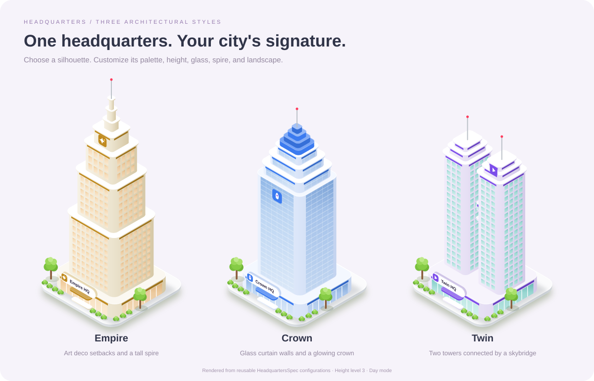

# Reusable headquarters buildings

[Documentation home](README.md) · [Component API](component-api.md)



The three skyscraper designs come from the updated `Isometric Campus.html`. Use the same typed specification for a standalone preview or a building on the city canvas.

## Preview a headquarters

```tsx
'use client';

import {
  HeadquartersBuilding, headquartersPresets, type HeadquartersSpec,
} from '@/components/agent-city';

const building: HeadquartersSpec = {
  ...headquartersPresets.crown,
  name: 'Creator HQ',
  height: 4,
  icon: 'rocket',
};

export default function HeadquartersPreview() {
  return <HeadquartersBuilding building={building} night={false} />;
}
```

`HeadquartersBuilding` accepts a required `building: HeadquartersSpec` and optional `selected`, `status`, `onSelect`, `night`, and `className`. It reuses the isolated building renderer. Its SVG framing accounts for the selected architecture, height, and spire, so tall previews remain inside the viewBox. `AgentBuilding` also accepts headquarters specs; `HeadquartersBuilding` provides a more specific typed interface for HQ-only uses.

## Configuration

All specs require `id`, `name`, `type: 'skyscraper'`, `x`, and `y`. `agentId` is optional; the default headquarters does not have an agent record.

| Field | Values | Renderer default |
| --- | --- | --- |
| `style` | `empire`, `crown`, `twin` | `empire` |
| `theme` | `lavender`, `mint`, `peach`, `sky`, `rose`, `white`, `gold` | `gold` |
| `height` | `1`, `2`, `3`, `4`, `5` | `3` |
| `tint` | `blue`, `teal`, `warm`, `clear` | `blue` |
| `icon` | `search`, `doc`, `wave`, `play`, `image`, `rocket`, `sparkle` | `sparkle` |
| `spire` | Boolean | `true` |
| `trees` | Boolean | `true` |

Height is a relative tower scale, not a floor count. The dedicated HQ options are exported as `headquartersStyles`, `headquartersThemes`, and `headquartersTints`. Agent office palette options stay unchanged; gold is available in the HQ interface.

The `headquarters` preset uses Empire, gold, height level 2, warm glass, a sparkle emblem, spire, and landscaping. The raw renderer's height default remains level 3. `headquartersPresets` supplies Empire, Crown, and Twin alternatives using the same ID and position. Clone and choose an alternative; do not add all three to a city that should contain exactly one headquarters.

## Switch architecture in a city

Headquarters renders through the same `AgentCity` building pipeline as offices. Change its spec in place so its ID, position, and road endpoints remain stable:

```tsx
setConfig(city => ({
  ...city,
  buildings: city.buildings.map(building =>
    building.id === HEADQUARTERS_ID && building.type === 'skyscraper'
      ? { ...building, style: 'twin', tint: 'teal' }
      : building),
}));
```

The landing page shows all three headquarters styles with `HeadquartersBuilding`. To add an interactive workspace, use the [integration example](integration.md) and add your own controls for the headquarters configuration. Keep its ID stable when changing appearance.

The initial camera is fixed. High towers or moved buildings may need panning or zooming to see fully on the city canvas; automatic framing applies to standalone previews, not the city camera. The height/footprint also does not change the free-plot spacing heuristic.

## Save a user's headquarters in Strapi

Signed-in users without a headquarters are redirected from `/dashboard` to `/headquarters/new`. That page renders the three designs with `HeadquartersBuilding` (each card reflects the chosen colors, icon, height, and toggles) and submits to a server action that validates the values against `headquartersStyles`, `headquartersThemes`, `headquartersTints`, and `buildingIcons`, then saves one record and redirects to `/dashboard`. A second submit never creates a second record. The form also sends the browser's time zone in a hidden field, which becomes the record's `timeZone`.

`lib/headquarters.ts` reads and writes the Strapi collection below. `toHeadquartersSpec(record)` turns a saved record back into a `HeadquartersSpec` with the stable `HEADQUARTERS_ID` and plot, ready for a city's `buildings`.

| Field | Strapi type | Values |
| --- | --- | --- |
| `name` | Short text, required, max 32 | Shown on the sign (first 16 characters) |
| `style` | Enumeration, required | `empire`, `crown`, `twin` |
| `theme` | Enumeration, required | `lavender`, `mint`, `peach`, `sky`, `rose`, `white`, `gold` |
| `height` | Integer, required, 1–5 | Relative tower scale |
| `tint` | Enumeration, required | `blue`, `teal`, `warm`, `clear` |
| `icon` | Enumeration, required | `search`, `doc`, `wave`, `play`, `image`, `rocket`, `sparkle` |
| `spire` | Boolean, default `true` | |
| `trees` | Boolean, default `true` | |
| `owner` | Relation: Headquarter has one User (users-permissions) | The Strapi profile from `ensureStrapiUser` |
| `x`, `y` | Integer, optional | Dragged plot; null keeps the preset plot `(290, 290)` |
| `agentsSeeded` | Boolean, default `false` | Set when the six starter agents were created, so they are seeded only once (see [Agents in Strapi](extending.md#agents-in-strapi)) |
| `timeZone` | Short text, optional, max 64 | IANA zone (e.g. `Asia/Kolkata`) for "today" in agent instructions and for times in activity lines; null or invalid uses the server's zone |
| `agentDefaults` | JSON, optional | `{ model, reasoningEffort, maxTurns, timeoutSeconds }` that new agents start with; missing or out-of-range values use the built-in defaults |
| `publishingApproval` | Enumeration `ask`, `auto`, default `ask` | Whether agents ask before posting with a connected account (see [Connected accounts](accounts.md#access-who-may-do-what)) |
| `displayName` | Short text, optional, max 64 | The owner's display name in the dashboard; null uses the name from sign-in |

Collection type display name **Headquarters**, singular API ID `headquarter`, plural API ID `headquarters` (REST: `/api/headquarters`). Turn off Draft & Publish so records are live immediately. The API token needs `find`, `create`, `update`, and `delete` on Headquarter. When adding an option to the public arrays, add it to the matching Strapi enumeration too.

## Settings page

`/dashboard/settings` (`app/dashboard/settings/`) edits the headquarters record with server actions (`actions.ts`); each action re-checks the session and touches only the caller's own headquarters. Form values are parsed by the client-safe helpers in `lib/workspace-settings.ts` (unit tested), and stored values are read back through `timeZoneFrom`, `agentDefaultsFrom`, and `publishingApprovalFrom`, which fall back to safe defaults.

**Workspace**

- **Time zone**: `timeZone`. `resolveTimeZone(hq.timeZone)` in `lib/ai/clock.ts` feeds `dateRules`, `describeNow`, and `staleYearsIn`; `clockTime`/`waitingActivity` show wait times in it. It replaces the former global `APP_TIMEZONE` variable. When none is saved, the page offers the browser's zone.
- **Headquarters**: the onboarding `HeadquartersForm` with `mode="edit"`, validated by the same `parseHeadquartersForm`. The ID, plot, and roads are unchanged.
- **New agent defaults**: `agentDefaults`, passed to `defaultRuntimeConfig(role, defaults)` by `ensureStarterAgents` and `createAgent`. Existing agents keep their own AI settings.
- **Publishing approval**: `publishingApproval`, applied by `toolPolicy` on every `run_app_tool`/`schedule_app_tool` call.

**Account**

- **Profile**: `displayName` (shown in the sidebar and profile menu); the sign-in email is read-only.
- **Danger zone** (`lib/workspace-data.ts`): **Clear shared memory** deletes the headquarters' `memories` rows only. **Delete headquarters** asks the user to type its name, then cancels queued and running tasks, disconnects every connected account (revoking it in Composio; a failure stops the deletion before any data is removed), stops the cloud computer, deletes every row of the headquarters in `task-events`, `chat-messages`, `agent-requests`, `external-waits`, `social-posts`, `artifacts`, `memories`, `media-assets` (and their media-library files), `conversations`, `agent-tasks`, `computer-sessions`, `connected-accounts`, and `agents`, then the headquarters itself, and redirects to `/headquarters/new`. The user's Strapi profile and sign-in stay. The token needs `delete` on those collections and on Upload files; the CloudHike computer itself is stopped, not removed. Deleting from Settings is the one way a headquarters is removed: the city still never deletes it.

## Compatibility and tests

Legacy `tower`, `stepped`, and `office` buildings remain available. The reusable renderer imports only the new skyscraper drawing functions and gold palette; it does not import the HTML's global listeners or state.

```bash
node --test components/agent-city/headquarters.test.mjs
```

The tests exercise 120 combinations of architecture, height, tint, and spire, plus all HQ palettes, instance-specific resource IDs, height bounds, and legacy building rendering. These are SVG DOM-double checks, not browser interaction tests. The guide's illustration was rendered from actual SVG drawing output and visually checked.
